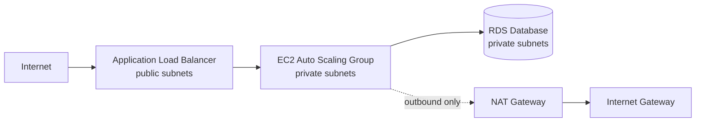

# Emmanuel Ese Omonake: Cloud Portfolio

-FF9900?logo=amazonaws&logoColor=white)


A single-page portfolio website for a **junior AWS Solutions Architect**. It presents hands-on AWS projects, technical skills, training and professional background in one fast, responsive page.

**Live site:** https://YOUR-USERNAME.github.io

---

## Table of contents

1. [Overview](#overview)
2. [Featured AWS projects](#featured-aws-projects)
3. [Skills](#skills)
4. [Education and training](#education-and-training)
5. [Professional background](#professional-background)
6. [Website features](#website-features)
7. [Tech stack](#tech-stack)
8. [Project structure](#project-structure)
9. [Getting started](#getting-started)
10. [Configuration](#configuration)
11. [Customization](#customization)
12. [Deployment](#deployment)
13. [Roadmap](#roadmap)
14. [Contact](#contact)

---

## Overview

I am a hands-on, detail-driven professional moving into cloud computing after 15+ years of technical work in building technology and MIG welding. That background taught me to read technical drawings, follow safety and quality standards, and finish what I start. I now apply the same discipline to secure and scalable cloud architecture.

- Preparing for the **AWS Certified Solutions Architect – Associate** exam
- Level 5 Extended Diploma in Cyber Security
- Self-directed AWS labs in networking, compute, scaling and databases
- Currently learning **Linux** and **Terraform**; comfortable with **Git and GitHub**
- Seeking a junior or entry-level **remote** cloud role

---

## Featured AWS projects

### 1. Three-tier architecture

A three-tier design that separates networking, application and database layers for security and isolation.



- Public and private subnets with correct routing; private resources reach the internet outbound-only through a NAT Gateway
- EC2 instances behind an Application Load Balancer, built from Launch Templates and Auto Scaling Groups
- RDS placed in private subnets, reachable only from the application tier through Security Group rules
- IAM roles and least-privilege policies, with high availability and scalability as design goals

**Services:** VPC, Subnets, Route Tables, IGW, NAT Gateway, EC2, Launch Templates, Auto Scaling, ALB, RDS, IAM, Security Groups

### 2. VPC networking and secure infrastructure

- Custom VPCs with segmented public and private subnets to model real-world network isolation
- Route tables controlling traffic between subnets, the Internet Gateway and the NAT Gateway
- Security Group rules enforcing least-privilege inbound and outbound access
- VPC Peering for private VPC-to-VPC communication

**Services:** VPC, Subnets, Route Tables, IGW, NAT Gateway, Security Groups, VPC Peering

### 3. Scalable web infrastructure

- EC2 instances provisioned from standardized Launch Templates for consistent, repeatable deployments
- Auto Scaling Groups adjusting capacity automatically, with an ALB distributing traffic across healthy instances
- Access restricted to required ports and sources only, with connectivity across environments through VPC Peering

**Services:** EC2, Launch Templates, Auto Scaling Groups, ALB, Security Groups, VPC Peering

---

## Skills

| Area | Technologies |
| --- | --- |
| Networking | VPC, Subnets, Route Tables, Internet Gateway, NAT Gateway, VPC Peering, Security Groups |
| Compute and scaling | EC2, AMI, Launch Templates, Auto Scaling, ELB, ALB, Target Groups |
| Storage and database | S3, RDS, CloudFront |
| Security and access | IAM, least-privilege access, cyber security fundamentals |
| DNS | Route 53 |
| Systems and security | Server administration, networking fundamentals, incident handling, Security+ topics |
| Version control | Git, GitHub |
| In progress | Linux, Terraform (infrastructure as code) |

---

## Education and training

| Qualification | Status |
| --- | --- |
| AWS Certified Solutions Architect – Associate | In progress |
| Level 5 Extended Diploma in Cyber Security, London Institute of Business and Technology (UK) | Started 2023 |
| Cisco Networking Academy (digital badges) | 2023 |
| Hacker Techniques, Tools, and Incident Handling | 2022 |
| CompTIA Security+ | Training course |
| Networking Certification, Crew Security (India) | Completed |
| National Diploma in Building Technology, Delta State Polytechnic (Nigeria) | Completed |

---

## Professional background

### MIG Welder · 2018 – Present · Italy

- Perform MIG (GMAW) welding on metal fabrication and assembly work to specification
- Read and work from technical drawings, meeting required tolerances and finish quality
- Follow workplace safety procedures and equipment-handling standards consistently
- Work as part of a team in an Italian-speaking environment, building working Italian

### Building Technology Practitioner · 2008 – 2016 · Nigeria

- Worked in building and construction following a National Diploma in Building Technology
- Applied knowledge of construction materials, measurements and building drawings on site
- Coordinated with crews and followed site safety and quality requirements
- Built a strong base in planning, structure and attention to detail that carries into cloud architecture design

---

## Website features

- **Single file:** the whole site lives in `index.html`, with no build step
- **Animated background:** gradient with a moving network graph drawn on a canvas
- **Responsive:** works on phones, tablets and desktops
- **Accessible:** visible keyboard focus, semantic HTML, and reduced-motion support for visitors who prefer less animation
- **Editable contact block:** change email, phone and social links in one place
- **Fast:** no frameworks or external scripts; only Google Fonts are loaded

---

## Tech stack

| Layer | Choice |
| --- | --- |
| Markup | HTML5 |
| Styling | CSS3 (custom properties, grid, flexbox) |
| Behavior | Vanilla JavaScript |
| Graphics | Canvas API |
| Fonts | Bricolage Grotesque, Instrument Sans (Google Fonts, with system fallbacks) |
| Hosting | GitHub Pages |

---

## Project structure

```
.
├── index.html   # the complete website (HTML, CSS and JavaScript)
└── README.md    # project documentation
```

---

## Getting started

```bash
git clone https://github.com/YOUR-USERNAME/YOUR-REPO.git
cd YOUR-REPO
```

Then open `index.html` in any browser. No installation is needed.

---

## Configuration

Open `index.html` and find the block marked `EDIT YOUR CONTACT DETAILS HERE`:

```js
const CONFIG = {
  email:    "you@example.com",
  phone:    "+00 000 000 0000",   // shown on the page
  phoneRaw: "+000000000000",      // digits only, used for tap-to-call
  github:   "https://github.com/your-username",
  linkedin: "https://linkedin.com/in/your-username"
};
```

| Field | Purpose |
| --- | --- |
| `email` | Shown on the page and used for every "Email me" button |
| `phone` | Display format of your number |
| `phoneRaw` | Digits only, used for tap-to-call on mobile |
| `github`, `linkedin` | Profile links; leave as `""` to hide the button |

---

## Customization

**Colors:** edit the variables at the top of the `<style>` section.

```css
:root{
  --accent:#ffb454;   /* buttons, highlights, hub nodes */
  --bg1:#070b24;      /* background gradient start */
  --bg2:#14185c;      /* background gradient middle */
  --bg3:#0b5a74;      /* background gradient end */
}
```

**Content:** each section (`#projects`, `#skills`, `#training`, `#history`, `#contact`) is plain HTML. Copy an existing card or timeline item to add a new one.

---

## Deployment

1. Create a repository named `.github.io`.
2. Upload `index.html` and `README.md` to the `main` branch.
3. Open **Settings → Pages**.
4. Under **Build and deployment**, choose **Deploy from a branch**, select `main` and `/ (root)`, then save.
5. Your site is live at `https://YOUR-USERNAME.github.io` within a few minutes.

**Custom domain (optional):** add your domain under **Settings → Pages → Custom domain** and create the DNS records GitHub lists.

---

## Roadmap

- [ ] Pass the AWS Certified Solutions Architect – Associate exam and add the badge
- [ ] Add architecture diagrams and screenshots for each AWS project
- [ ] Rebuild the three-tier architecture as code with Terraform
- [ ] Add Linux and shell scripting projects
- [ ] Link project write-ups to individual GitHub repositories

---

## Contact

| | |
| --- | --- |
| **Name** | Emmanuel Ese Omonake |
| **Role** | Junior AWS Solutions Architect |
| **Email** | [esedandolor1@gmail.com](mailto:esedandolor1@gmail.com) |
| **Phone** | [+39 331 152 9444](tel:+393311529444) |
| **Location** | Chiaravalle, Ancona, Italy |
| **Nationality** | Nigerian (Delta State) |
| **Languages** | English (fluent), Italian (basic) |
| **Availability** | Open to remote roles |
| **GitHub** | [(https://github.com/exceldolor/Emmanuel-ese-cloud-portfolio.gi) |
| **LinkedIn** | www.linkedin.com/in/emmanuel-ese-omonake-51158a242 |

---

© Emmanuel Ese Omonake. All rights reserved. You are welcome to take inspiration from the layout.
